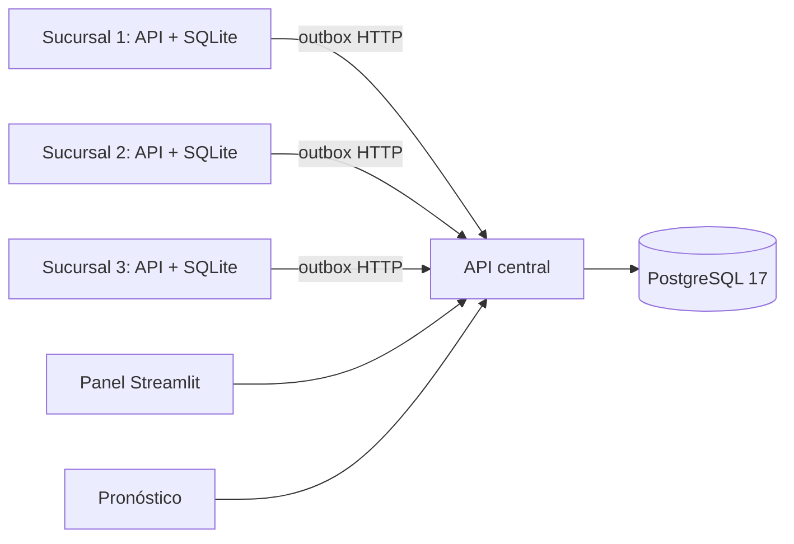

# Arquitectura prevista

Esta es una propuesta para etapas posteriores, no una descripción de componentes ya implementados. El MVP simulará tres sucursales y diez productos, con inventario inicial, ventas, sincronización y pronóstico. Quedan fuera pagos, devoluciones y transferencias.

## Componentes y propiedad de datos

- Un monorepositorio Python 3.12: FastAPI para las API, SQLAlchemy 2 y Alembic para persistencia y migraciones. Cada sucursal tendrá su propia base SQLite; PostgreSQL 17 almacenará el estado central.
- Cada sucursal es autoridad exclusiva de su stock y valida ventas localmente. El central conserva proyecciones eventualmente consistentes y no autoriza ventas locales.
- HTTPX enviará eventos; Streamlit y Plotly presentarán el panel. pandas y scikit-learn servirán al análisis y pronóstico. `uv` gestionará el entorno; pytest, Ruff y mypy verificarán el proyecto. Las versiones compatibles se resolverán y bloquearán al crear el entorno.
- Docker Compose ejecutará tres instancias de sucursal, central, PostgreSQL y panel. Desconectar una sucursal significará bloquear únicamente la comunicación de sincronización: su API y su base local seguirán activas.



## Transacciones y contrato de eventos

Una venta válida, su descuento de inventario y la inserción del evento en la outbox se confirmarán en una sola transacción local. Una operación fallida no dejará efectos parciales; se impedirá vender más unidades que las disponibles. El dinero se representará en centavos enteros y las cantidades vendidas en unidades enteras positivas. Las fechas de eventos serán UTC; la fecha comercial se determinará en `America/Guayaquil`.

Cada evento tendrá al menos identificador único, versión de esquema, identificador de sucursal, secuencia monotónica por sucursal, tipo, fecha UTC y carga útil. Los movimientos identificarán el producto, la venta y el cambio de unidades. La secuencia se asignará de forma transaccional con la outbox. El envío HTTP será **al menos una vez** y podrá repetir eventos; no se promete entrega exactly-once. El central registrará persistentemente cada identificador y aplicará sus efectos en una misma transacción. Una repetición idéntica se reconocerá sin aplicar de nuevo; una colisión de identificador con contenido distinto se rechazará y señalará.

El inventario central comenzará con un snapshot inicial versionado por sucursal, que incluye su secuencia de corte y existencias por producto. Solo se aplicarán movimientos posteriores a ese corte, en orden de secuencia por sucursal. El central persistirá el último número aplicado; ante un hueco no avanzará ni aplicará eventos posteriores de esa sucursal hasta recuperar los faltantes. Un snapshot antiguo o igual no sobrescribirá stock más reciente; uno nuevo solo se aceptará mediante un procedimiento explícito de reconciliación que verifique su versión y corte, y preserve o reaplique los movimientos posteriores. El protocolo concreto y la recuperación de huecos se implementarán y probarán en etapas posteriores.

## Errores y recuperación

Errores de validación o stock insuficiente rechazarán la venta sin efectos parciales. Fallos de red o del central conservarán la outbox pendiente para reintento; un acuse solo marcará enviado el evento confirmado por el central. Errores transitorios serán reintentables; esquemas inválidos, conflictos de identidad y huecos se registrarán y expondrán para diagnóstico sin descartar datos silenciosamente. La implementación definirá límites y política de reintentos.

## Pronóstico

Se comparará un promedio histórico con Ridge usando separación temporal de entrenamiento, validación y prueba. Las características y transformaciones se ajustarán solo con información disponible hasta cada corte, sin datos futuros. Las métricas y resultados se definirán y medirán al implementar, sin anticiparlos.

## Estructura futura

```text
src/retail_intelligence/
  branch/
  central/
  forecasting/
  dashboard/
  shared/
  cli.py
migrations/{branch,central}/
tests/{unit,integration,e2e}/
docs/
.github/workflows/
compose.yaml
Dockerfile
pyproject.toml
uv.lock
.env.example
README.md
```

`shared` contendrá contratos y configuración comunes, sin mezclar lógica de negocio. Dentro de cada módulo se separarán rutas, servicios y persistencia cuando tengan responsabilidades reales.

## Fases y criterios de aceptación

1. Fundamentos: reglas, exclusiones y documentación inicial; no se requiere aplicación ejecutable.
2. Aplicación y persistencia: tres sucursales independientes; ventas, descuento de stock y outbox atómicos; pruebas de invariantes y fallos.
3. Sincronización: snapshot inicial versionado, orden y recuperación de huecos; reintentos y deduplicación persistente y atómica, comprobados ante duplicados y desconexiones.
4. Pronóstico y panel: comparación temporal sin fuga de información y visualización de datos disponibles.
5. Integración: Compose y comprobaciones automatizadas de los flujos y fallos relevantes. El orden y alcance detallado de las etapas posteriores se concretarán en sus instrucciones.

## Base ejecutable actual

Las API exponen vida del proceso y readiness mediante una consulta SELECT 1 a la base configurada; esta comprobación no certifica migraciones ni datos de negocio. Compose asigna un volumen SQLite independiente por sucursal y uno a PostgreSQL. Las URLs entre contenedores usan nombres de servicio; los puertos del host se limitan a 127.0.0.1. Cada sucursal ejecuta un único worker. El publicador aún no existe: al implementarlo se ejecutará en ese proceso único por sucursal, sin réplicas ni workers adicionales hasta disponer de coordinación segura. Ventas, outbox, migraciones, sincronización y pronósticos siguen pendientes.
