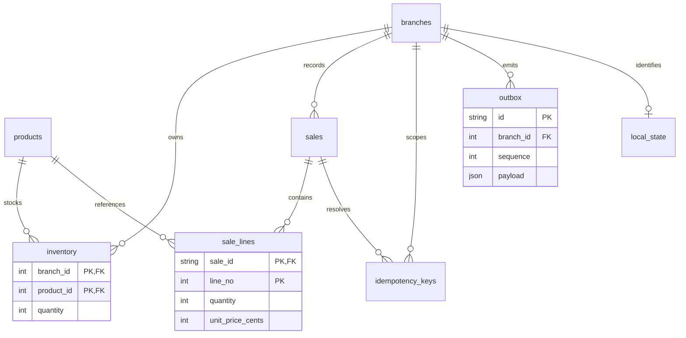
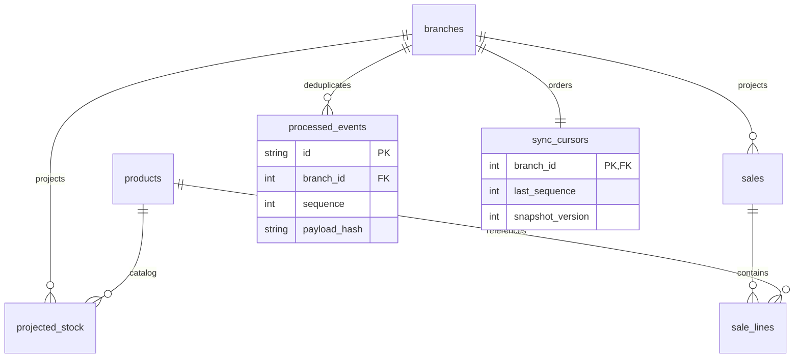

# Persistencia y semilla inicial

Implementado en esta etapa: esquemas separados SQLAlchemy Core, revisiones Alembic
`branch_0001` y `central_0001`, inicialización transaccional y proyección del snapshot
inicial. Existen endpoints de ventas locales; el publicador HTTP de la outbox sigue pendiente.

## Propiedad y claves

Cada SQLite pertenece a una sucursal. Contiene las tres sucursales de referencia,
los diez productos y únicamente las diez existencias de su sucursal. `local_state`
registra la identidad de la base y la siguiente secuencia; cambiar `BRANCH_ID` sobre
una base ya inicializada falla sin modificarla. Los modelos de cada frontera viven
en `branch/models.py` y `central/models.py`; `shared` contiene contratos, catálogo
de demostración y utilidades de infraestructura, no servicios de negocio.

Las tablas centrales `sales` y `sale_lines` son proyecciones. El stock central solo
se llena aplicando el evento inicial; su seed no inserta existencias.

| Tabla | Clave / regla principal |
|---|---|
| branches | PK `id`, nombre único |
| products | PK `id`, SKU único, precio en centavos enteros no negativos |
| inventory / projected_stock | PK `(branch_id, product_id)`, ambas FK, cantidad entera >= 0 |
| sales | PK `id` UUID textual, FK sucursal, instante UTC y fecha comercial |
| sale_lines | PK `(sale_id, line_no)`, FK venta/producto, cantidad entera > 0 y precio histórico >= 0 |
| idempotency_keys | PK `(branch_id, key)`, hash de solicitud y FK compuesta a venta de esa misma sucursal |
| outbox | PK evento UUID, único `(branch_id, sequence)`, versión, tipo, fecha UTC, JSON y acuse opcional |
| local_state | Fila única `id=1`, FK sucursal única, `next_sequence >= 2` |
| processed_events | PK evento, único `(branch_id, sequence)`, hash del evento aplicado |
| sync_cursors | PK/FK sucursal, última secuencia y versión de snapshot no negativas |

Índices adicionales: ventas por sucursal/fecha comercial, líneas por producto y
outbox por acuse/secuencia. Las restricciones únicas crean sus propios índices.
No se borran en cascada ventas ni datos de auditoría. El precio de catálogo puede
cambiar sin modificar `unit_price_cents` de líneas ya registradas.

Los eventos se validan en UTC. SQLite almacena los DateTime sin zona como UTC por
convención; PostgreSQL usa TIMESTAMP WITH TIME ZONE. `business_date` se reserva
para la fecha calculada en America/Guayaquil al registrar ventas.

## Modelo local

## Modelo central

## Seed versión 1

Sucursales: IDs 1, 2 y 3, nombres `Sucursal 1`, `Sucursal 2` y `Sucursal 3`.
Cada producto empieza con **100 unidades por sucursal**: 1.000 unidades locales,
3.000 en el sistema. IDs y SKU son estables.

| ID | SKU | Producto | Precio (centavos) |
|---|---|---|---:|
| 1 | SKU-001 | Arroz 1 kg | 150 |
| 2 | SKU-002 | Leche 1 L | 110 |
| 3 | SKU-003 | Pan | 200 |
| 4 | SKU-004 | Huevos 12 unidades | 300 |
| 5 | SKU-005 | Aceite 1 L | 250 |
| 6 | SKU-006 | Azúcar 1 kg | 120 |
| 7 | SKU-007 | Sal 1 kg | 80 |
| 8 | SKU-008 | Café 250 g | 400 |
| 9 | SKU-009 | Agua 1 L | 75 |
| 10 | SKU-010 | Pasta 500 g | 130 |

El seed local inserta catálogo, existencias, estado y un único evento
`inventory.initialized` (esquema 1, snapshot 1, secuencia/corte 1) en la misma
transacción. El UUID del evento deriva de sucursal y versión. Al repetirlo,
`local_state` evita nuevas inserciones: no repone stock vendido, cambia precios,
duplica filas ni regenera el timestamp del snapshot. No se eliminan snapshots de
la outbox en esta etapa. El seed central inserta referencias faltantes y cursores
en cero sin sobrescribir datos ni crear inventario.

`central.snapshots.apply_initial_snapshot` es el único servicio implementado que
crea stock proyectado. Valida el contrato completo de diez productos, bloquea el
cursor en PostgreSQL, y confirma stock, evento procesado y cursor en una sola
transacción. Un duplicado idéntico es un no-op; un ID reutilizado con contenido
distinto o un snapshot nuevo sobre un cursor ya avanzado se rechaza. Un duplicado
antiguo nunca restaura existencias descontadas. Se prueban rollback y entregas
simultáneas. El transporte HTTP y su publicador aún no están implementados: por
eso el central del proyecto permanece sin stock, con snapshot pendiente local.

Las ventas locales toman secuencias desde `local_state.next_sequence` (2 en
adelante) en la misma transacción de venta/outbox. El publicador deberá enviar en
orden y esperar el acuse de la secuencia 1 antes de enviar ventas. El receptor de
ventas deberá aceptar únicamente `last_sequence + 1`; los huecos no avanzarán el
cursor. Esta etapa no incorpora recepción de ventas ni simula ese flujo.

## Arranque, migraciones y concurrencia

Antes de aceptar solicitudes, cada lifespan ejecuta migración y seed usando la
misma conexión/transacción. Un fallo revierte ambas operaciones y aborta el
arranque. No se usa `create_all()` como sustituto de migraciones.

SQLite: `foreign_keys=ON` por conexión, `busy_timeout=5000`, journal DELETE y
`synchronous=FULL`. `BEGIN IMMEDIATE` reserva al escritor antes de leer el estado;
solo hay un escritor, y los bloqueos esperan hasta cinco segundos. No se utiliza
SELECT FOR UPDATE en SQLite. Si expira la espera, el arranque falla y puede
reintentarse. DELETE prioriza sencillez; lectores pueden esperar al commit.

PostgreSQL: el arranque usa `pg_advisory_xact_lock(74123901)` y espera de bloqueo
de diez segundos. La proyección usa bloqueo del cursor por sucursal, exclusivo de
PostgreSQL. Un lock del proceso serializa además el contexto global de Alembic.
Las pruebas lanzan dos procesos contra la misma base nueva en ambos motores.

Los árboles `migrations/branch` y `migrations/central` tienen env y revisiones
independientes; cada base tiene su propia tabla `alembic_version`. El DDL de las
revisiones está congelado y no importa modelos mutables. Las revisiones se
empaquetan dentro del wheel. El comando `python -m retail_intelligence.cli init`
conserva los bloqueos; no se ofrece un comando de migración sin esas garantías.

Referencias técnicas: [transacciones SQLite](https://www.sqlite.org/lang_transaction.html),
[PRAGMA](https://www.sqlite.org/pragma.html) y
[conexión compartida de Alembic](https://alembic.sqlalchemy.org/en/latest/cookbook.html#sharing-a-connection-across-one-or-more-programmatic-migration-commands).

## Ventas locales

`POST /sales` valida cantidades enteras positivas y producto único por línea.
Ordena las líneas por producto y calcula SHA-256 sobre el JSON canónico para
comparar el contenido asociado a cada clave. `BEGIN IMMEDIATE` serializa la
lectura de la clave y las escrituras. Un `UPDATE` condicional por producto
descuenta únicamente si hay stock suficiente. Venta, líneas con precio
histórico, secuencia, evento `sale.created` y clave se confirman juntos; errores
revierte la transacción. Ante SQLITE_BUSY o SQLITE_LOCKED se reintenta toda la
operación hasta tres veces con espera progresiva; cada intento respeta el
`busy_timeout` de cinco segundos. La fecha comercial usa America/Guayaquil y
el instante de evento es UTC. La outbox permanece pendiente de transporte.
